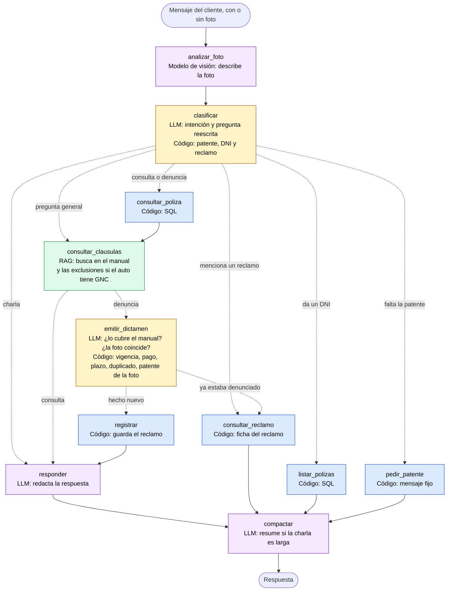

# Documentación Técnica — TP2: Agente Conversacional de Seguros

> **Sistema experto** de seguros automotor basado en **RAG + agentes inteligentes**,
> construido con LangChain, LangGraph, Groq, ChromaDB y HuggingFace.

---

## 1. Descripción del sistema

"San Cris" es un asistente virtual para una aseguradora (San Cristóbal) capaz de:

- Responder preguntas sobre el contenido de una póliza (**RAG** sobre el manual).
- **Determinar si un siniestro está cubierto o no** y fundamentarlo.
- Consultar el estado, plan y datos de una póliza (por patente o por DNI).
- Registrar siniestros en una base relacional y emitir número de reclamo.
- Usar **resoluciones previas** (siniestros históricos) como precedentes.
- Mantener **memoria conversacional** entre turnos.

El sistema es un **sistema experto funcional**: recupera información relevante,
toma decisiones y dialoga en lenguaje natural, cumpliendo los objetivos del enunciado.

---

## 2. Caso de negocio

Los seguros están llenos de "letra chica" (condiciones, exclusiones, franquicias).
Los clientes no leen los PDFs y no entienden si un evento está cubierto.

El agente resuelve esto:
1. El cliente describe su situación en lenguaje natural.
2. El sistema recupera las cláusulas relevantes del manual (RAG).
3. Cruza la información con la póliza real del cliente (base relacional).
4. Emite un **dictamen** (cubierto / rechazado / requiere peritaje) con fundamento.

La fuente de verdad es el manual de San Cristóbal (`poliza_sanCristobal.pdf`,
27 páginas) y una base SQLite con datos sintéticos.

---

## 3. Arquitectura general

```
Usuario (chat web, con fotos / consola)
        │
        ▼
┌──────────────────────────────────────────────────────────────┐
│                 GRAFO DE ESTADO (LangGraph)                   │
│                                                               │
│  analizar_foto (visión) → clasificar (LLM + regex)            │
│     ├── responder (charla)                                    │
│     ├── consultar_clausulas (pregunta general, RAG)           │
│     ├── listar_polizas (DNI)                                  │
│     ├── consultar_reclamo (ficha armada por código)           │
│     ├── pedir_patente                                         │
│     └── consultar_poliza (SQL) → consultar_clausulas (RAG)    │
│            → emitir_dictamen (LLM + controles con código)     │
│            → registrar → responder                            │
│  Todos los caminos terminan en compactar (resume si hace falta)│
│  Memoria: checkpointer + thread_id + resumen                  │
└───────────┬───────────────────────┬───────────────┬──────────┘
            │                       │               │
      ┌─────▼──────┐        ┌───────▼──────┐  ┌─────▼──────────┐
      │  SQLite    │        │  ChromaDB    │  │  Groq          │
      │ (pólizas,  │        │ (manual      │  │ gpt-oss-120b,  │
      │ reclamos)  │        │ vectorizado) │  │ respaldo 20b,  │
      └────────────┘        └──────────────┘  │ visión qwen)   │
                                              └────────────────┘
```

**Flujo de una denuncia:**

```
foto (si hay) → patente (regex) → póliza (SQL) → cláusulas y exclusiones (RAG)
  → precedentes → dictamen (LLM) → comparación foto-relato (LLM, llamada aparte)
  → controles (código: vigencia, pago, plazo, duplicado, patente de la foto)
  → registrar → responder
```

El grafo completo, coloreado según quién decide cada paso (código, RAG o LLM),
está en §25.

---

## 4. Stack tecnológico

| Componente | Tecnología | Por qué |
|---|---|---|
| Orquestación | **LangGraph** (`StateGraph`) | Control explícito del flujo (grafo de estado), no un ReAct a ciegas |
| Framework | **LangChain** (`@tool`, retriever, loaders) | Requisito del enunciado |
| LLM | **Groq** — `openai/gpt-oss-120b`, con `openai/gpt-oss-20b` de respaldo | Free tier: 200K tokens/día por modelo y por cuenta, 30 req/min. Rápido (500 tps). Si el principal agota su cupo, pasa solo al respaldo (§20) |
| Visión | **Groq** — `qwen/qwen3.8-27b` | El único modelo de Groq que acepta imágenes. Solo describe la foto: no decide (§26) |
| Structured output | `json_schema` (nativo de Groq) | Fuerza el schema del lado del servidor |
| Base vectorial | **ChromaDB** (espacio coseno) | Persistencia local, simple |
| Embeddings | **`intfloat/multilingual-e5-base`** | Entrenado específicamente para retrieval |
| Retrieval | **Híbrido** (BM25 + semántico) | `EnsembleRetriever` + `rank_bm25` |
| Base relacional | **SQLite** | Mock de la fuente de datos transaccional |
| Frontend | **Streamlit** | Chat con fotos, recorrido guiado, costo por consulta y selector de modelo |
| Config | `python-dotenv` + `.env` | Secretos fuera del código |
| PDF | `pypdf` + `PyPDFLoader` | Carga del manual |

---

## 5. Componentes (archivos)

| Archivo | Responsabilidad |
|---|---|
| `config.py` | Carga `.env`, paths, modelos y constantes centralizadas |
| `database.py` | Schema SQLite (clientes, vehículos, pólizas, siniestros) + consultas |
| `rag.py` | Pipeline RAG: carga PDF, chunking, embeddings, Chroma, retrieval híbrido |
| `tools.py` | Herramientas del agente decoradas con `@tool` |
| `agent.py` | Grafo de estado LangGraph (nodos, routing, prompts, memoria) |
| `main.py` | Loop interactivo por consola |
| `app.py` | Interfaz web Streamlit (chat + memoria por sesión) |
| `costos.py` | Costo estimado de cada turno y de la conversación, a partir de los tokens |
| `llm.py` | Creación de los modelos, modelo de respaldo y disyuntor (§20) |
| `iniciar.py` | Instala todo la primera vez y abre el chat, con un solo comando (§23) |

---

## 6. Herramientas del agente (`@tool`)

| Tool | Input | Acción |
|---|---|---|
| `consultar_datos_poliza` | patente | Consulta SQL: póliza, titular, producto, franquicia, estado |
| `consultar_clausulas_poliza` | consulta | Búsqueda RAG híbrida en el manual |
| `consultar_polizas_por_dni` | dni | Lista las pólizas de un titular |
| `consultar_estado_reclamo` | número de reclamo | Devuelve la ficha completa del reclamo: vehículo, hecho, relato, foto, dictamen, motivo y estado |
| `consultar_siniestros_previos` | límite, tipo, patente (opcionales) | Devuelve siniestros históricos con su dictamen (precedentes), del mismo producto si se da la patente |
| `registrar_siniestro` | patente, tipo, fecha, lesionados, dictamen, motivo, descripción de la foto | INSERT en `siniestros` + número de reclamo |

---

## 7. El grafo de estado (LangGraph)

**Estado** (`EstadoAgente`): `messages`, `intencion`, `consulta`, `patente`, `dni`,
`reclamo`, `datos_poliza`, `clausulas`, `exclusiones`, `dictamen`,
`siniestro_registrado`, `reclamo_resultado`, `resumen`, `reclamo_ya_denunciado`,
`foto`, `descripcion_foto`, `patente_foto`, `aviso_foto`.

**Nodos:**

| Nodo | Qué hace |
|---|---|
| `analizar_foto` | Si el mensaje trae una foto, el modelo de visión la describe; sin foto no hace nada (§26) |
| `clasificar` | Extrae patente/DNI con **regex** + clasifica intención con LLM (`json_schema`). Ve los últimos mensajes y devuelve además la pregunta reescrita para que se entienda sola, que es la que se usa para buscar (§15) |
| `pedir_patente` | Pide la patente si falta |
| `listar_polizas` | Lista las pólizas de un DNI y pide elegir |
| `consultar_reclamo` | Responde con la ficha completa del reclamo, armada por código, sin LLM |
| `consultar_poliza` | Llama a la tool de SQL |
| `consultar_clausulas` | RAG híbrido sobre el manual; si el vehículo tiene GNC, además busca las exclusiones que dependen de eso (§14) |
| `emitir_dictamen` | El LLM analiza la cobertura (póliza, cláusulas, exclusiones, precedentes, foto). Después, una llamada aparte compara foto y relato, y el código controla vigencia, pago, plazo de denuncia, duplicados y patente de la foto (§21, §24, §26). Si el hecho ya estaba denunciado, pasa a `consultar_reclamo` en vez de registrar |
| `registrar` | INSERT del siniestro en SQLite |
| `responder` | Genera la respuesta final en lenguaje natural |
| `compactar` | Al final de cada turno: si el historial llegó a 12 mensajes, resume los viejos y deja los últimos 6 (§16) |

**Routing** (señales explícitas del mensaje actual > intención del LLM):
```
reclamo (si se menciona) → consultar_reclamo
dni/patente (en el mensaje) → listar_polizas / consultar_poliza
general                  → consultar_clausulas
charla                   → responder
consulta/siniestro con patente recordada → consultar_poliza
(ninguno)                → pedir_patente
```

**Memoria:** `MemorySaver` (checkpointer) + `thread_id` por sesión. Los campos
`patente`, `dni` y `reclamo` se **preservan entre turnos**; los campos "por
turno" (dictamen, cláusulas, etc.) se resetean en `clasificar`. El historial
se mantiene acotado con una ventana + resumen (§16).

---

## 8. Pipeline RAG

1. **Carga**: `PyPDFLoader` sobre el manual (27 páginas).
2. **Limpieza**: se excluye el índice (páginas 0-2) porque concentra keywords
   y contamina la búsqueda semántica.
3. **Chunking estructural**: se divide por los **ítems numerados** del manual
   (`1)`, `2)`, `10) Granizo`...) con `re.split(r"(?=^\d+\))")`. Ítems muy
   largos se subdividen con `RecursiveCharacterTextSplitter` (1000 / overlap 300).
   *Motivo*: el chunking por caracteres separaba el título del contenido.
4. **Etiquetado por sección** según la página (A/B/C/D/General).
5. **Embeddings**: `multilingual-e5-base` con prefijos `query:` / `passage:`.
6. **Retrieval híbrido**: `BM25Retriever` (léxico) + `as_retriever` (semántico)
   fusionados con `EnsembleRetriever` (pesos 0.5/0.5).

---

## 9. Decisiones de diseño (con tradeoffs)

1. **Groq en vez de Gemini** → el free tier de Gemini limita a 20 req/día;
   Groq da 1.000 req/día. Costo: modelo distinto (GPT-OSS).
2. **`json_schema` en vez de `function_calling`** → más robusto ante inputs
   ambiguos. Costo: menos flexible que function calling.
3. **e5 en vez de MiniLM/mpnet** → los modelos de "similitud" no discriminan
   términos raros de dominio. Costo: e5 requiere prefijos query/passage.
4. **Retrieval híbrido (BM25 + semántico)** → combina exactitud léxica y
   comprensión semántica. Costo: complejidad extra y pesos a tunear.
5. **Grafo de estado explícito en vez de ReAct** → control total del flujo y
   del dictamen. Costo: más código que un `create_react_agent`.
6. **Extracción determinística de patente/DNI (regex)** → robusta, no depende
   del LLM. Costo: menos flexible para formatos no previstos.
7. **Controles con código después del dictamen** (vigencia, pago, plazo de
   denuncia, duplicados, patente de la foto) → siempre dan lo mismo; el LLM
   interpreta y el código verifica hechos (§21, §24, §25). Costo: reglas del
   negocio escritas en el código.
8. **Modelo de respaldo con disyuntor** → el sistema no se queda sin responder
   por falta de cupo, y no reintenta el modelo agotado en cada consulta (§20).
   Costo: el respaldo razona peor.
9. **Una tarea por llamada al LLM** → la comparación foto-relato falló como regla
   y como campo del dictamen, y funcionó como llamada aparte (§26). Costo: una
   llamada más cuando hay foto.
10. **El modelo de visión describe, no decide** → la decisión sigue con el modelo
    principal y sus controles (§26). Costo: un modelo más, cinco veces más caro.
11. **La ficha del reclamo sin LLM** → siempre completa, y el turno pasa de
    ~4.000 a ~900 tokens. Costo: no puede agregar nada fuera de la ficha.
12. **Memoria con ventana + resumen** → el historial no crece sin límite (§16).
    Costo: el resumen puede deformar un detalle.

---

## 10. Dificultades encontradas y soluciones

> **Esta sección responde directamente al criterio de evaluación
> "Identificación de dificultades".**

| # | Problema | Causa raíz | Solución |
|---|---|---|---|
| 1 | Gemini agotaba quota (429) | Free tier = 20 req/día | Migrar a **Groq** (1.000 req/día) |
| 2 | `gemini-2.5-flash` deprecado (404) | Google retiró modelos 2.5 | Usar `gemini-3.6-flash`, luego Groq |
| 3 | Gemini 3.x devuelve contenido como lista de bloques | Nuevo formato con "thought signature" | Helper `extraer_texto()` |
| 4 | `function_calling` alucinaba nombres de campo (`{"consulta":...}` en vez de `{"intencion":...}`) | LLM produce tool calls malformados en inputs ambiguos | `method="json_schema"` + fallback heurístico |
| 5 | El LLM no mapeaba "patente AB123CD" → "póliza POL-1001" | El output de la tool no incluía la patente | Hacer el output de la tool **auto-descriptivo** |
| 6 | Dictamen decía "cubierto" para choque con póliza C+ | El LLM no conocía la taxonomía de coberturas | Agregar mapeo producto→cobertura al prompt |
| 7 | La memoria no funcionaba entre turnos | `nodo_clasificar` sobreescribía `patente` con "" | Preservar patente del estado anterior |
| 8 | El número de reclamo nunca aparecía | `siniestro_registrado` no estaba en el schema del estado | Agregarlo al `EstadoAgente` |
| 9 | "granizo" no se recuperaba | MiniLM/mpnet no discriminan términos raros | **e5** + prefijos query/passage |
| 10 | El header "10) Granizo" quedaba separado de su cuerpo | Chunking por caracteres cortaba mal | **Chunking estructural** por ítems |
| 11 | BM25 no matcheaba "granizo" (score 0) | Tokenizer naive: sensible a mayúsculas y puntuación | `preprocess_func` propio (lowercase + regex) |
| 12 | El índice/TOC contaminaba la búsqueda | Concentra todas las keywords | Excluir páginas del índice |
| 13 | El LLM inventaba emails/teléfonos | Alucinación cuando el contexto no alcanza | Endurecer el prompt anti-alucinación |
| 14 | Alucinaba portales/apps/emails al preguntar por el estado del reclamo | No existía tool para consultar el reclamo | Tool `consultar_estado_reclamo` + anti-alucinación en responder |
| 15 | El patente recordado "secuestraba" el routing (consultar reclamo iba a consultar_poliza) | El patente persistido se chequeaba antes que las señales del mensaje | Priorizar señales explícitas del mensaje actual |
| 16 | Respuesta vacía del modelo | Flakiness del LLM / rate limits | Fallback en `nodo_responder` |
| 17 | Clasificador impreciso ("datos de la patente" → general) | Prompt de clasificación vago | Prompt con definiciones + ejemplos |
| 18 | Siniestros rechazados quedaban "Iniciado" | `estado_reclamo` hardcodeado | Estado según dictamen (`ESTADO_POR_DICTAMEN`) |
| 19 | `dni` no se preservaba entre turnos | Faltaba preservarlo como patente/reclamo | Preservar dni del estado anterior |
| 20 | Streamlit no abría: `OSError [WinError 123]` en bucle | Streamlit 1.64 dejó de interpretar el shortcode `page_icon=":car:"` y lo buscaba como archivo estático; `:` es inválido en nombres de archivo en Windows | Emoji literal `"🚗"` |
| 21 | El entorno no era reproducible | `requirements.txt` sin versiones fijadas: `pip install` trae lo último de cada día (así se coló el bug 20) | `requirements-lock.txt` con las 139 versiones probadas |
| 22 | Exclusión por GNC aplicada fuera de su alcance | El chunking partía por ítems numerados y cada ítem quedaba **sin el encabezado que le da ámbito**. El chunk recuperado decía sólo "5) Cuando el vehículo haya sido adaptado para GNC", sin indicar que pertenece a *Exclusiones para Robo o Hurto* | Propagar el encabezado de lista a cada ítem (numerado y con viñetas) al indexar |
| 23 | Robo e incendio de un auto con GNC salían cubiertos, aunque el manual los excluye | La búsqueda usaba solo el texto del usuario, que no menciona el GNC: la exclusión nunca se recuperaba | Segunda búsqueda, dirigida a exclusiones, cuando el vehículo tiene GNC según la base (§14) |
| 24 | Las preguntas de seguimiento ("¿y cuándo vence?") se clasificaban y buscaban sueltas | El clasificador y la búsqueda leían solo el último mensaje | El clasificador recibe los últimos mensajes y devuelve la pregunta reescrita, en la misma llamada al LLM (§15) |
| 25 | El historial que se mandaba al LLM crecía sin límite | El nodo que responde enviaba toda la conversación en cada turno | Ventana + resumen: al llegar a 12 mensajes se resumen los viejos y quedan los últimos 6 (§16) |
| 26 | Al decir "Hola" respondía "No dispongo de la información necesaria… indicame tu patente" | Un saludo se clasifica como charla y llega al nodo que responde sin contexto; en ese caso se le agregaba la advertencia anti-alucinación pensada para consultas sin datos ("decí que no podés responder y pedí patente o DNI"). "Hola, ¿de qué sirve este chat?" andaba bien por casualidad: se clasificaba como pregunta general, buscaba en el manual y llegaba con contexto | Para la charla, una instrucción propia: saludar, presentarse, contar qué puede hacer, y avisar con amabilidad si el tema no es de seguros. La advertencia queda para los demás casos sin contexto |
| 27 | Al agotarse el cupo diario, el chat mostraba el error crudo de la API, con el número de organización de Groq | `app.py` y `main.py` mostraban el texto de la excepción tal cual | `mensaje_para_el_usuario` lo traduce a *"El sistema no puede responder consultas en este momento. Probá de nuevo en 21 minutos."*, calculando la espera que informa la API. El detalle técnico se imprime en la terminal. Además se verificó que el cupo es **por modelo** (con `gpt-oss-120b` agotado, `gpt-oss-20b` respondía con la misma key), y se corrigió el comentario de `config.py` que decía lo contrario |
| 28 | Una póliza vencida salía cubierta | El prompt del dictamen no pedía comparar la fecha del siniestro con la vigencia, y el modelo no lo hacía aunque tenía las dos fechas a la vista | La vigencia y el pago los controla el código después del dictamen; si no están en regla, el dictamen pasa a Rechazado con un fundamento del sistema (§21) |
| 29 | Al consultar un reclamo, respondía solo "El reclamo #43 está en estado Iniciado" | La herramienta devolvía pocos datos, el motivo del dictamen no se guardaba, y el LLM resumía la ficha: con el modelo de respaldo, incluso después de pedirle en el prompt todos los datos, respondió solo "Iniciado." | Se guarda el motivo (columna `fundamento_ia`, con migración automática para las bases existentes) y **la respuesta es la ficha armada por el código**, sin pasar por el LLM: siempre completa, y el turno pasa de ~4.000 a ~900 tokens (solo la clasificación). Además, el ruteo mira también la pregunta reescrita ("¿y por qué me lo aprobaron?" → "¿Por qué me aprobaron el reclamo #47?"), y al consultar un reclamo el agente recuerda la patente de ese auto |
| 30 | El plazo de denuncia se evaluaba distinto según la redacción: "me robaron el auto el 10 de mayo" se cubría y "…y recién ahora hago la denuncia" se rechazaba | Lo decidía el modelo leyendo el relato, y una fecha pasada no alcanza para saber si la denuncia se hace ahora o si el cliente habla de un reclamo que ya hizo. Además, el mismo hecho denunciado dos veces generaba dos reclamos | Lo decide el código mirando la base: si ya hay un reclamo de ese auto con esa fecha, se muestra ese reclamo y no se registra otro; si no, la denuncia es de hoy y, si pasaron más de 72 horas desde el hecho, se rechaza con un motivo escrito por el sistema (§24) |
| 31 | El modelo de visión rechazaba todos los pedidos | En el plan gratuito limita la salida a 1.000 tokens por minuto y rechaza de entrada los pedidos que *podrían* pasarse; sin un máximo, Groq estimaba 1.226 | `max_tokens=400` y razonamiento apagado (el razonamiento cuenta como salida). Una descripción usa ~110 tokens (§26) |
| 32 | El modelo de visión confundía granizo con nieve e inventaba un vuelco | Sus respuestas son muy sensibles a la redacción de las instrucciones | Se probaron tres redacciones con las mismas fotos y se eligió la única que no inventó nada (§26) |
| 33 | Una foto de un choque con un relato de granizo salía cubierta | La comparación foto-relato era una regla del prompt del dictamen, y después un campo más de su formulario: en medio del prompt largo quedaba diluida y el modelo chico la salteaba | Llamada aparte, corta y enfocada, que solo compara foto y relato; si no coinciden, el código pone *Requiere peritaje*. Aislada, los dos modelos la resuelven bien (§26) |
| 34 | Dos hechos distintos del mismo auto el mismo día se tomaban como duplicados (en el recorrido: el granizo del paso 11 se confundía con el robo del paso 7) | El control de duplicados comparaba solo auto y fecha | Compara también la familia del tipo de siniestro (robo, incendio, granizo, cristales, choque) (§26) |

---

## 11. Cómo ejecutar

**La forma recomendada es un solo comando: `python iniciar.py`**, que instala todo
la primera vez y abre el chat (ver `README.md` y §23). Lo que sigue es la
instalación manual, para desarrollo.

```bash
# 1. Crear entorno e instalar
python3 -m venv .venv
.venv/bin/pip install -r requirements.txt

# 2. Configurar la API key de Groq en .env
#    GROQ_API_KEY=tu_key  (obtenela en https://console.groq.com/keys)

# 3. Interfaz web
.venv/bin/streamlit run app.py

#    O consola
.venv/bin/python main.py
```

La base SQLite y Chroma se generan solas en `data/` la primera vez.

---

## 12. Funcionalidades implementadas

- ✅ Chat conversacional con memoria entre turnos.
- ✅ RAG sobre el manual (retrieval híbrido BM25 + embeddings).
- ✅ Dictamen de cobertura con fundamento (cubierto/rechazado/peritaje).
- ✅ Registro de siniestros + número de reclamo.
- ✅ Consulta por patente y por DNI.
- ✅ Consulta del estado de un reclamo por su número.
- ✅ Resoluciones previas como precedentes.
- ✅ Interfaz web (Streamlit) y consola.
- ✅ Manejo de rate limits con reintentos.
- ✅ Costo estimado de cada turno y de la conversación, visible en el chat.
- ✅ Modelo de respaldo automático cuando el principal agota su cupo diario.
- ✅ Selector de modelo en la web.
- ✅ Fotos del cliente: un modelo de visión las describe y el dictamen las usa como evidencia.
- ✅ Recorrido sugerido en la web: 12 consultas en orden (2 con foto), cada una con un botón.
- ✅ Preguntas de seguimiento y memoria con resumen para charlas largas.
- ✅ Vigencia, pago y plazo de denuncia controlados con código.
- ✅ Detección de reclamos duplicados (mismo auto, fecha y tipo de hecho).
- ✅ Ficha completa del reclamo, con el motivo del dictamen.
- ✅ Mensaje amigable ante errores de la API.
- ✅ Instalación y arranque con un solo comando (`python iniciar.py`).

## 13. Limitaciones y mejoras futuras

- **El dictamen puede variar:** con el modelo principal, el robo del auto todo
  riesgo con GNC salió cubierto 1 de 5 veces (§24). Se decidió aceptarlo y
  explicarlo.
- **El modelo de visión puede equivocarse** y es muy sensible a la redacción de
  sus instrucciones (en una versión confundió granizo con nieve). Por eso no
  decide: su descripción pasa por la comparación con el relato (§26).
- **Fotos:** solo en la web y una por mensaje.
- **El plazo de denuncia** no contempla caso fortuito o fuerza mayor (§24).
- **Granizo o parabrisas sobre un auto con GNC:** el manual es ambiguo y la
  respuesta depende del modelo (§14, §19).
- Las exclusiones que dependen del vehículo solo contemplan el **GNC** (§14).
- El modelado de GNC no distingue "declarado vs no declarado".
- La tabla de límites (pág 5) a veces rankea alto (falso positivo menor).
- El agente no elige herramientas por sí mismo (patrón ReAct): el flujo es un
  grafo determinístico. Está en desarrollo (ver `PENDIENTES.md`).

---

## 14. El bug del GNC: diagnóstico y arreglo

### El problema

El sistema daba por cubiertos siniestros que el manual excluye para vehículos
adaptados a GNC. El manual tiene **tres** listas que mencionan esa exclusión, y
cada una tiene un alcance distinto:

| Página | Alcance de la exclusión |
|---|---|
| 10 | General — *"excepto que la cobertura incluya alguno de los puntos enumerados"* |
| 15 | Sólo **Incendio** |
| 16 | Sólo **Robo o Hurto** |

### Cómo se probó

Seis siniestros, cada uno en una conversación nueva, cruzando el tipo de
siniestro con los dos autos de prueba: el Peugeot 208 (`AF987XX`, producto C+,
**con GNC**) y el Ford Focus (`AB123CD`, producto D, sin GNC). "Según el
manual" es la respuesta que corresponde leyendo las cláusulas. Antes de cada
corrida se vació la tabla `siniestros`, para que los dictámenes de corridas
anteriores no influyeran como precedentes.

| Pregunta literal | Según el manual | Original | Etapa 1 | Etapa 2 |
|---|---|---|---|---|
| *Me cayo granizo sobre la AF987XX* | **Ambiguo** | Rechazado | Requiere peritaje | Cubierto |
| *Me rompieron el parabrisas de la AF987XX* | **Ambiguo** | Cubierto | Cubierto | Cubierto |
| *Se incendio por completo la AF987XX* | **Rechazado** (pág. 15) | Cubierto ❌ | Cubierto ❌ | Rechazado ✅ |
| *Me robaron el auto AF987XX* | **Rechazado** (pág. 16) | Cubierto ❌ | Cubierto ❌ | Rechazado ✅ |
| *Me cayo granizo sobre la AB123CD* | Cubierto | Cubierto ✅ | Cubierto ✅ | Cubierto ✅ |
| *Me robaron el auto AB123CD* | Cubierto | Cubierto ✅ | Cubierto ✅ | Cubierto ✅ |

**Los casos ambiguos.** La lista general de pág. 10 excluye los vehículos con
GNC, pero con la salvedad *"excepto que la cobertura incluya alguno de los
puntos enumerados"*. Las listas de pág. 15 y 16 repiten la exclusión solo para
incendio y robo, lo que sugiere que ahí está su alcance real. Para granizo y
cristales el manual no es concluyente: tanto "Cubierto" como "Requiere
peritaje" son defendibles.

> **Corrección.** En la primera versión de esta batería el incendio figuraba
> como esperado "Cubierto" y, por lo tanto, como caso correcto. Releyendo el
> manual, la lista *"Exclusiones a la cobertura para Incendio"* de pág. 15
> incluye el GNC: lo correcto es **Rechazado**. Era un segundo falso positivo,
> con la misma causa que el robo.

### Etapa 1 — Los fragmentos perdían su encabezado (commit `148f605`)

**Causa.** El chunking partía el manual por ítems numerados, y cada ítem
quedaba sin el título que le da alcance. El fragmento recuperado decía solo
*"5) Cuando el vehículo haya sido adaptado para ser propulsado por GNC"*, sin
indicar que pertenece a *Exclusiones a la cobertura para Robo o Hurto*. El LLM
lo leía como una exclusión absoluta.

**Arreglo.** Al indexar, cada ítem (numerado o con viñeta) lleva adelante el
encabezado de su lista.

**Resultado.** La exclusión dejó de aplicarse donde no correspondía: el granizo
dejó de rechazarse. Pero el robo y el incendio seguían saliendo cubiertos.

### Etapa 2 — La exclusión nunca se recuperaba

**Causa.** No era un problema de razonamiento sino de **recuperación**. La
búsqueda en el manual usaba solo el texto del usuario, y nadie escribe "tengo
GNC" al denunciar un robo. Para *"Me robaron el auto AF987XX"*, ninguno de los
12 fragmentos recuperados contenía la exclusión, así que el LLM nunca la veía.
El dato "este vehículo tiene GNC" estaba en SQL (`vehiculos.tiene_gnc`), pero
no se usaba para buscar.

**Arreglo.** En `nodo_consultar_clausulas`, si la intención es una consulta o
un siniestro y el vehículo tiene GNC, se hace una **segunda búsqueda**:

1. Con una consulta armada por el sistema, no por el usuario
   (`CONSULTA_EXCLUSIONES_GNC`).
2. Quedándose solo con los fragmentos que son exclusiones y mencionan el GNC
   (`rag.buscar_exclusiones`). Así queda afuera, por ejemplo, el texto que
   obliga a *declarar* el equipo de GNC, que no es una exclusión.
3. El resultado entra al prompt del dictamen en una sección propia, *EXCLUSIONES
   POR CARACTERÍSTICAS DEL VEHÍCULO*, y el prompt suma una regla: cada exclusión
   se aplica solo a la cobertura que indica su encabezado.

**Por qué una búsqueda aparte** y no agregar "GNC" a la pregunta del usuario:
los fragmentos sobre robo y los de GNC competirían por los mismos 12 lugares y
se desplazarían entre sí. Separados, cada búsqueda trae lo suyo, y en el prompt
queda claro qué es el relato y qué son las exclusiones.

**Resultado.** 6 de 6. El robo y el incendio pasaron a *Rechazado*. El granizo
y el parabrisas siguen *Cubierto* aunque ahora el modelo **ve** las
exclusiones: las lee y entiende que no aplican a esas coberturas.

**Costo.** Una búsqueda extra, local (no consume API), y solo para vehículos
con GNC.

### Limitaciones

- Solo se contempla el **GNC**, que es la característica que se verificó. El
  manual también excluye vehículos adaptados a gas licuado de petróleo, pero la
  base de datos no registra ese dato. Otra característica se sumaría con el
  mismo mecanismo: su consulta, sus palabras clave y el dato en la base.
- En los casos ambiguos (granizo, cristales) el sistema hoy responde "Cubierto".
  Si el grupo decide que lo correcto es "Requiere peritaje", hay que ajustar el
  prompt del dictamen.


---

## 15. Preguntas de seguimiento

### El problema

El clasificador y la búsqueda en el manual leían **solo el último mensaje**.
Una pregunta que depende de la conversación llegaba suelta:

- *"¿Y cuándo vence?"*, después de consultar una póliza, se clasificaba como
  pregunta **general** sobre el manual, no como consulta de la póliza. La
  respuesta salía bien por casualidad: la fecha estaba en el historial.
- *"¿Y me cubre el granizo?"* buscaba en el manual sin saber de qué póliza se
  hablaba.

### La solución

El clasificador ya llamaba al LLM en cada turno. Se aprovecha esa misma
llamada: ahora recibe los **últimos 4 mensajes** (cada uno recortado a 300
caracteres) y, además de la intención, devuelve la pregunta **reescrita para
que se entienda sola** (campo `consulta_autonoma` del schema, `consulta` en el
estado). Esa versión es la que se usa para buscar en el manual. En la base de
datos se sigue guardando el mensaje original del usuario.

Se descartaron dos alternativas:

| Alternativa | Por qué no |
|---|---|
| Una llamada extra al LLM, solo para reescribir, en todos los mensajes | Suma demora y cupo en cada turno |
| Reescribir solo si el mensaje "parece" de seguimiento (corto, empieza con "¿y...") | Una regla fija se equivoca con frases que no previó |

**Costo:** ninguna llamada extra al LLM, solo unos cientos de tokens más de
entrada por turno. En el primer mensaje de una conversación no hay historial y
la entrada queda igual que antes.

### Un riesgo que hubo que cubrir

Con el historial a la vista, una **hipótesis** después de un siniestro (*"¿y
si hubiera sido granizo?"*) podía clasificarse como un siniestro nuevo, y el
sistema habría **registrado un reclamo que nunca ocurrió**. El prompt del
clasificador ahora aclara que "siniestro" es solo un hecho que ocurrió; una
hipótesis es una consulta.

### Resultados

| Conversación | Intención | Pregunta reescrita | Resultado |
|---|---|---|---|
| *¿Qué plan tengo para la patente AB123CD?* → *Y cuando vence?* | `consulta` (antes: `general`) | *¿Cuándo vence la póliza de la patente AB123CD?* | ✅ |
| *¿Qué plan tengo para la patente AF987XX?* → *y me cubre el granizo?* | `consulta` | *¿Me cubre el granizo la póliza de la patente AF987XX?* | ✅ cita la cláusula del granizo |
| *Choque contra un poste con la AF987XX* → *y si hubiera sido granizo?* | `consulta` | *¿Estaría cubierto mi vehículo si el daño hubiera sido causado por granizo?* | ✅ no registró ningún reclamo |

Se repitió además la batería del GNC (§14) para verificar que el clasificador
nuevo no cambiara los dictámenes.


---

## 16. Memoria de la conversación: ventana + resumen

### El problema

El nodo que responde mandaba al LLM **toda** la conversación en cada turno.
En una charla larga, lo que se envía crece sin límite: se gasta el cupo diario
de tokens de Groq (200.000 por modelo) y la respuesta se degrada por el
ruido acumulado.

### La solución

Es el patrón que documenta LangGraph para este caso: el estado guarda, además
de los mensajes, un **resumen** de la conversación. El nodo `compactar` corre
al final de cada turno:

- Mientras el historial tiene **menos de 12 mensajes**, no hace nada (ni llama
  al LLM).
- Al llegar a 12, le pide al LLM que incorpore los mensajes viejos al resumen
  (actualizando el anterior, si existe), y **los borra del estado** con
  `RemoveMessage`. Quedan los **últimos 6** completos, empezando siempre por
  una pregunta del usuario.

Como cada turno suma dos mensajes (pregunta y respuesta), se resume **una vez
cada 3 turnos**. Los números están en `config.py`
(`HISTORIAL_UMBRAL_RESUMEN`, `HISTORIAL_MENSAJES_A_CONSERVAR`).

El LLM ve siempre dos cosas: el resumen de lo viejo y los últimos mensajes
completos. El resumen llega al nodo que responde y también al clasificador,
para que entienda referencias a cosas que se hablaron hace varios turnos.

**Decisiones de diseño:**

| Decisión | Motivo |
|---|---|
| Comprimir de a tandas (12 → 6) y no en cada turno | Si se resumiera cada vez que se pasa de 6, habría una llamada extra al LLM en todos los turnos |
| El nodo corre al **final** del turno | La conversación tiene pares completos pregunta-respuesta, y todos los caminos del grafo pasan por él (incluidos los que no pasan por `responder`) |
| El resumen conserva patentes, reclamos, dictámenes y lo que quiere el cliente | La patente, el DNI y el reclamo ya viven en el estado; el resumen se ocupa del hilo de la charla |
| Si el resumen falla, no se borra nada | Es preferible un historial más largo por un turno que perder contexto |

**Qué no cambia:** la pantalla de Streamlit guarda su propia copia del chat,
así que el usuario sigue viendo toda la conversación. Y el **dictamen no usa el
resumen**: arma su contexto con datos frescos de la base y del manual, así que
un error del resumen no puede cambiar una decisión de cobertura.

### Resultados

Charla de 8 turnos. En el primero el usuario cuenta algo que no queda en ningún
campo del estado (que piensa vender el Focus); en el séptimo, después de la
compresión, pregunta por eso.

| Turno | Mensaje del usuario | Mensajes en el estado | Resumen |
|---|---|---|---|
| 1 | *Hola, soy Carlos. Estoy pensando en vender el Focus el mes que viene.* | 2 | no |
| 2 | *Que plan tengo para la patente AB123CD?* | 4 | no |
| 3 | *Que es la franquicia?* | 6 | no |
| 4 | *Que es CLEAS?* | 8 | no |
| 5 | *Que cubre el granizo?* | 10 | no |
| 6 | *Que es Asistencia 24?* | **6** (se comprimió) | **sí** |
| 7 | *Que te habia dicho que pensaba hacer con el Focus?* | 8 | sí |
| 8 | *Y cual era la franquicia de mi poliza?* | 10 | sí |

En el turno 6 se resumieron los tres primeros intercambios. El resumen quedó así:

> Carlos, DNI no proporcionado, consultó la póliza de la patente AB123CD.
> Producto D c/fran, suma asegurada $25.000.000, franquicia fija $460.000, uso
> particular sin GNC, rastreador sí, pago al día, vencimiento 2027-01-01.
> Preguntó qué es la franquicia; se le explicó que es el importe que paga el
> asegurado en siniestro, $460.000 en su caso, con detalle de aplicación y
> tipos. También manifestó intención de vender su Focus el mes próximo,
> solicitando información al respecto.

En el turno 7, con esos mensajes ya borrados del estado, respondió: *"Me
comentaste que tenés la intención de vender tu Focus el mes próximo y que
buscabas información al respecto."* El dato sobrevivió gracias al resumen.

**Una imprecisión observada:** el resumen agregó *"solicitando información al
respecto"*, que el usuario nunca pidió, y la respuesta del turno 7 lo repitió.
Es el riesgo esperable de resumir con un LLM. Queda acotado porque el dictamen
no usa el resumen.

**Tokens por turno** (entrada + salida, sumando todas las llamadas al LLM del
turno): entre 3.000 y 5.200 de entrada. El turno 6, que incluye la llamada del
resumen, fue el más caro en salida (1.888). Buena parte de la entrada de cada
turno son las cláusulas recuperadas del manual (~3.000 tokens), no el
historial: en charlas cortas el ahorro es chico, y lo que aporta el resumen es
que el historial deje de crecer en las largas.


---

## 17. Costo estimado de cada consulta

### Qué se muestra

- **En la web:** debajo de cada respuesta, en letra chica, los tokens y el
  costo de ese turno. En la barra lateral, el total de la conversación.
- **En la consola:** después de cada respuesta, el costo del turno y el
  acumulado.

Formato: *"4.172 tokens (3.900 de entrada + 272 de salida) · US$ 0,0007"*.

### Cómo se calcula

Cada llamada al LLM informa cuántos tokens de entrada y de salida usó. Durante
un turno, `UsageMetadataCallbackHandler` (de LangChain) suma los de **todas**
las llamadas: clasificar, dictaminar, responder y, cuando corresponde, resumir.
`costos.py` multiplica esos tokens por los precios de `config.py`
(`PRECIOS_USD_POR_MILLON`). Los embeddings corren localmente y no tienen costo.

Precios de `openai/gpt-oss-120b` en el plan pago de Groq (consultados el
2026-09-23 en la documentación del modelo):

| | USD por millón de tokens |
|---|---|
| Entrada | 0,15 |
| Entrada en caché | 0,075 |
| Salida | 0,60 |

**Con el plan gratuito el costo real es cero.** El número indica cuánto
costaría la misma consulta en el plan pago; la interfaz lo aclara.

**Tokens de razonamiento.** `gpt-oss` es un modelo que "piensa" antes de
contestar, y esos tokens se cobran como salida aunque no se vean. En una
prueba con una respuesta de una palabra, 93 de los 105 tokens de salida fueron
de razonamiento.

### Costos medidos

| Tipo de turno | Tokens | Costo estimado |
|---|---|---|
| Consulta de la póliza (*¿Qué plan tengo para la patente AB123CD?*) | ~4.100 | US$ 0,0008 |
| Pregunta de seguimiento (*Y cuando vence?*) | ~4.200 | US$ 0,0007 |
| Denuncia de siniestro (*Me robaron el auto AF987XX*): clasifica, dictamina y responde | ~9.100 | US$ 0,0019 |

Un dictamen cuesta unos US$ 0,002: **unos 500 dictámenes por dólar**. Con el
cupo gratuito de 200.000 tokens diarios alcanza para unos 20 dictámenes o 45
consultas por día.


---

## 18. Datos de prueba

La base se crea sola con datos sintéticos (`database.inicializar_base`). Cada
auto está pensado para probar **una sola cosa**: con los dos autos originales
no alcanzaba, porque el único con GNC era también el único C+ y no se podía
saber cuál de las dos cosas causaba un rechazo.

| Patente | Auto | Titular (DNI) | Póliza | Qué prueba |
|---|---|---|---|---|
| AB123CD | Ford Focus 2024 | Carlos Perez (39123456) | Todo riesgo (`D c/fran`), franquicia fija $460.000 | Caso base: cubre casi todo |
| AF987XX | Peugeot 208 2012, **con GNC** | Carlos Perez (39123456) | C+ | Exclusiones por GNC (robo e incendio) |
| AC456BD | VW Gol Trend 2018 | Laura Gomez (30555777) | C+, **sin GNC** | El robo se cubre: el rechazo del AF987XX es por el GNC, no por el plan |
| AD789EF | Chevrolet Cruze 2022, **con GNC** | Laura Gomez (30555777) | Todo riesgo | La exclusión por GNC se aplica aun con el mejor plan |
| AE321GH | Fiat Uno 2008 | Laura Gomez (30555777) | Plan A (solo daños a terceros) | Un daño al propio auto se rechaza |
| AG654JK | Renault Kangoo 2015 | Martin Diaz (28444666) | Plan B (daños totales) | El robo total se cubre; un daño parcial, no |
| AH111LM | Toyota Etios 2019 | Martin Diaz (28444666) | C+, **impaga** | Cualquier siniestro se rechaza |
| AJ222NP | Honda Fit 2014 | Martin Diaz (28444666) | C+, **vencida** en junio de 2026 | Cualquier siniestro se rechaza |

Las bases que ya existían incorporan los autos nuevos en el próximo arranque
(los inserts son `INSERT OR IGNORE`).

### Resultados

Con la tabla `siniestros` vacía, para que no influyan precedentes de pruebas
anteriores:

| Pregunta | Esperado | Resultado |
|---|---|---|
| *Me robaron el auto AC456BD* (C+ sin GNC) | Cubierto | ✅ Cubierto |
| *Me robaron el auto AD789EF* (todo riesgo con GNC) | Rechazado | ✅ Rechazado, citando las exclusiones por GNC |
| *Choque contra un poste con la AE321GH, se abollo la puerta* (plan A) | Rechazado | ✅ Rechazado (batería final) |
| *Me robaron el auto AG654JK* (plan B) | Cubierto | ✅ Cubierto (batería final) |
| *Choque contra un poste con la AG654JK, se abollo la puerta* (plan B) | Rechazado | ✅ Rechazado (batería final) |
| *Me robaron el auto AH111LM* (impaga) | Rechazado | ✅ Rechazado (batería final) |
| *Me robaron el auto AJ222NP* (vencida) | Rechazado | ✅ Rechazado, por el control de vigencia con código (§21) |

Los dos primeros confirman lo que no se podía demostrar con un solo auto con
GNC: con el mismo plan y sin GNC el robo se cubre, y con GNC se rechaza incluso
con el mejor plan. Los cinco restantes se cortaron por el cupo diario y se
corrieron después, en la batería final con el modelo principal (§24).


---

## 19. Prueba con el modelo chico (`gpt-oss-20b`)

Con el cupo diario de `gpt-oss-120b` agotado, se corrieron las dos baterías
(las 6 preguntas del GNC y las 7 de los autos de prueba) con `gpt-oss-20b`,
que tiene su propio cupo. El código no cambió: el modelo se reemplazó solo
dentro del script de prueba. Antes de cada batería se vació la tabla
`siniestros`, y al terminar se restauró la base.

| Pregunta | Esperado | `gpt-oss-120b` | `gpt-oss-20b` |
|---|---|---|---|
| *Me cayo granizo sobre la AF987XX* (GNC) | Ambiguo | Cubierto | **Rechazado** |
| *Me rompieron el parabrisas de la AF987XX* (GNC) | Ambiguo | Cubierto | Cubierto |
| *Se incendio por completo la AF987XX* (GNC) | Rechazado | ✅ | ✅ |
| *Me robaron el auto AF987XX* (GNC) | Rechazado | ✅ | ✅ |
| *Me cayo granizo sobre la AB123CD* | Cubierto | ✅ | ✅ |
| *Me robaron el auto AB123CD* | Cubierto | ✅ | ✅ |
| *Me robaron el auto AC456BD* (C+ sin GNC) | Cubierto | ✅ | ✅ |
| *Me robaron el auto AD789EF* (todo riesgo con GNC) | Rechazado | ✅ | ✅ |
| *Choque contra un poste con la AE321GH…* (plan A) | Rechazado | sin correr (cupo) | ✅ |
| *Me robaron el auto AG654JK* (plan B) | Cubierto | sin correr (cupo) | ✅ |
| *Choque contra un poste con la AG654JK…* (plan B) | Rechazado | sin correr (cupo) | ✅ |
| *Me robaron el auto AH111LM* (impaga) | Rechazado | sin correr (cupo) | ✅ |
| *Me robaron el auto AJ222NP* (vencida) | Rechazado | sin correr (cupo) | ❌ **Cubierto** |

**Conclusiones:**

- **El modelo chico es un respaldo viable:** coincide con el grande en todos
  los casos claros.
- **Donde el manual es ambiguo, la respuesta depende del modelo.** Ante el
  granizo sobre un auto con GNC, el modelo chico leyó la lista general de
  exclusiones al pie de la letra (*"una exclusión general que excluye cualquier
  siniestro cuando el vehículo está adaptado…"*) e ignoró la salvedad del
  "excepto". Mientras el grupo no decida qué respuesta es la correcta y la
  escriba como regla, el resultado no es estable.
- **La póliza vencida sale cubierta.** No es un problema del modelo chico sino
  del sistema: el reclamo se registró con la fecha de hoy (el modelo la conoce)
  y la póliza tenía el vencimiento a la vista, pero el prompt del dictamen no
  tiene ninguna regla sobre la vigencia, y el modelo no las comparó. En el
  fundamento escribió *"la póliza está al día"*, que se refiere al pago.


---

## 20. Modelo de respaldo y disyuntor

El plan gratuito de Groq limita los tokens diarios **por modelo**. El sistema
usa `gpt-oss-120b` y, cuando agota su cupo, pasa solo a `gpt-oss-20b`, que
tiene el suyo. La prueba con el modelo chico mostró que coincide con el
principal en todos los casos claros.

**El disyuntor.** Sin él, cada consulta intentaría primero el modelo agotado,
fallaría y recién ahí pasaría al respaldo. Cuando un modelo responde "cupo
diario agotado, probá de nuevo en 20 minutos", `llm.py` anota hasta cuándo está
bloqueado y, mientras tanto, **ni lo intenta**. Pasado ese tiempo vuelve a
probar con el principal. Si los dos están agotados, el chat muestra el mensaje
amigable con la espera más corta.

El estado vive en memoria y lo comparten todas las sesiones de la app, porque
el cupo es de la key y no de cada usuario. Si la app se reinicia se pierde: el
primer intento vuelve a detectar el bloqueo, y un rechazo por cupo no consume
tokens.

**Cómo se implementó.** Todas las llamadas al LLM pasan por `llm.invocar`, que
recibe una función para armar el pedido a partir del modelo. Así, el mismo
pedido (texto o salida estructurada) se puede repetir con el respaldo:

```python
invocar_llm(lambda m: m.with_structured_output(DictamenSiniestro, method="json_schema"), mensajes)
invocar_llm(lambda m: m, mensajes)  # respuesta de texto
```

`llm.py` es además el único lugar donde se crean los modelos (`make_llm`), y los
nombres de los dos modelos están en `config.py`.

**Elegir el modelo desde la web.** La barra lateral tiene un selector: el modelo
elegido pasa a ser el principal y el otro queda de respaldo, con el mismo
disyuntor. La elección vale para toda la app (`llm.elegir_modelo_principal`),
lo que alcanza para un uso local. Sirve, por ejemplo, para mostrar en vivo la
diferencia entre los dos modelos en un caso ambiguo. Probado: al elegir
`gpt-oss-20b` respondió él (US$ 0,0001 el turno) y la barra indicó el
respaldo; al volver, el orden se restableció.

**Qué ve el usuario.** Si respondió el respaldo, debajo de la respuesta aparece
*"Respondido con el modelo de respaldo (openai/gpt-oss-20b): el principal agotó
su cupo diario"*, y el costo se calcula con el precio de ese modelo.

**Pruebas.** Con modelos simulados (sin gastar API):

| Situación | Resultado |
|---|---|
| El principal sin cupo | Responde el respaldo |
| Dos consultas más | El principal **no se vuelve a intentar**: 1 solo intento en total |
| Pasa el tiempo de bloqueo | Vuelve a responder el principal |
| Los dos sin cupo | *"El sistema no puede responder consultas en este momento. Probá de nuevo en 21 minutos."* |

Y con la API real, dos consultas (un saludo y una consulta de póliza) pasaron
por el código nuevo y las respondió el principal, confirmando que el camino
normal no cambió.


---

## 21. Vigencia y pago de la póliza: control sin LLM

### El problema

Una póliza vencida salía **cubierta**. En la prueba con el modelo chico, el
reclamo se registró con la fecha correcta (el modelo conoce la fecha de hoy) y
la póliza tenía el vencimiento a la vista, pero el prompt del dictamen no pedía
compararlos, y el modelo no lo hizo. En el fundamento escribió *"la póliza está
al día"*, que se refiere al pago.

### La solución

Comparar fechas y leer un estado guardado en la base no requiere interpretar
nada, así que **no se le delega al modelo**: lo hace el código.

1. El modelo sigue extrayendo del relato la fecha del siniestro ("ayer", "el 10
   de mayo"). Si la fecha no es válida o es futura, se usa la de hoy.
2. `motivo_de_rechazo_administrativo` compara esa fecha con la vigencia de la
   póliza (`database.obtener_vigencia`) y revisa el estado de pago.
3. Si la póliza no estaba vigente o no está paga, el dictamen pasa a
   **Rechazado** con un fundamento escrito por el sistema, sin importar lo que
   haya dicho el modelo.

El control de pago antes lo hacía el modelo por una regla del prompt. Funcionaba,
pero es la misma clase de verificación, así que también pasó al código.

### Resultados

Sin gastar API:

| Situación | Resultado |
|---|---|
| AB123CD, al día y vigente | En regla: decide el análisis de cobertura |
| AJ222NP, vencida el 01/06/2026, siniestro de hoy | *"La póliza POL-1008 no estaba vigente en la fecha del siniestro: venció el 01/06/2026 y el siniestro es del 23/09/2026."* |
| AJ222NP, siniestro del 10/05/2026 (antes del vencimiento) | En regla: una denuncia tardía de algo que pasó cuando la póliza cubría |
| AC456BD, siniestro anterior al inicio de la póliza | *"…todavía no estaba vigente en la fecha del siniestro: empezó el 01/03/2026…"* |
| AH111LM, impaga | *"…tiene el pago pendiente (estado: Impaga). Sin el pago al día no hay cobertura."* |
| Fecha extraída inválida ("ayer" sin convertir) o futura | Se usa la de hoy |

Con la API real:

| Pregunta | Resultado |
|---|---|
| *Me robaron el auto AJ222NP* | **Rechazado**: *"…la póliza POL-1008 venció el 01/06/2026, mientras el robo ocurrió el 23/09/2026."* |
| *El 10 de mayo de 2026 me robaron el auto AJ222NP y recién ahora hago la denuncia* | Fecha extraída: 10/05/2026, dentro de la vigencia, así que pasó al análisis. El análisis lo **rechazó por otro motivo, legítimo**: el manual exige denunciar dentro de las 72 horas |

El segundo caso muestra la división de tareas: el código compara las fechas y
el modelo interpreta el manual.

**Observación:** con la frase *"Me robaron el auto AJ222NP el 10 de mayo de
2026"*, el modelo chico la clasificó como consulta y no como denuncia, y no
llegó al dictamen. Hay que revisar si con el modelo principal pasa lo mismo.


---

## 22. Recorrido sugerido en la web

Para compensar que la entrega no es un notebook, la barra lateral del chat
ofrece un **recorrido sugerido**: diez consultas en orden, cada una con un
botón. Al tocarlo, la consulta se envía como si se hubiera escrito, y debajo de
cada botón se explica qué muestra. El chat sigue disponible para escribir
cualquier otra consulta.

| Paso | Consulta | Qué muestra |
|---|---|---|
| 1 | *Hola, ¿quién sos?* | Charla: se presenta y cuenta qué puede hacer |
| 2 | *¿Qué plan tengo para la patente AB123CD?* | Consulta la póliza en la base de datos |
| 3 | *¿Y cuándo vence?* | Memoria: sigue hablando del mismo auto |
| 4 | *¿Qué cubre el granizo?* | Busca en el manual de la póliza (RAG) |
| 5 | *Choqué contra un poste con la AB123CD, se abolló la puerta* | Dictamen cubierto con franquicia y registro del reclamo |
| 6 | *¿En qué estado está mi reclamo?* | Consulta el reclamo recién registrado |
| 7 | *Me robaron el auto AC456BD* | Robo con plan C+ sin GNC: cubierto |
| 8 | *Me robaron el auto AF987XX* | Mismo robo y mismo plan, con GNC: rechazado por una exclusión del manual |
| 9 | *Me robaron el auto AJ222NP* | Póliza vencida: la rechaza un control del sistema, sin el LLM |
| 10 | *Mi DNI es 30555777* | Busca por DNI y lista las pólizas |

El recorrido completo usa unos 60.000 tokens (cuatro dictámenes de ~9.000 y
seis consultas más livianas), menos de un tercio del cupo diario del modelo
principal.

Se descartaron dos alternativas: una pestaña aparte con tarjetas explicativas
(obliga a ir y venir entre la pestaña y el chat) y una reproducción automática
de todo el recorrido (el profesor mira de forma pasiva y se gasta mucho cupo de
una vez).

**Prueba:** con un agente simulado (sin gastar API), los botones envían
exactamente su consulta, en el orden en que se tocan, y se combinan con las
consultas escritas a mano.


---

## 23. Instalación y arranque con un solo comando

Para compensar que la entrega no es un notebook, el objetivo es que el profesor
pase de la carpeta descomprimida al chat funcionando **con un solo comando y sin
tomar decisiones**: `python iniciar.py`.

### Qué hace `iniciar.py`

La primera vez:

1. Explica qué va a instalar y dónde, y pide confirmación.
2. Revisa la versión de Python (compatible: 3.11 a 3.13; probado con 3.13).
3. Crea el entorno virtual e instala las librerías **desde `requirements-lock.txt`**,
   con las versiones exactas que se probaron.
4. Descarga el modelo de embeddings, crea la base de datos y arma el índice del
   manual. Antes, esa descarga pasaba con la primera pregunta, que tardaba varios
   minutos y parecía colgada.
5. Verifica la API key de Groq: si no hay una en `.env`, la pide y la guarda.
   La validación lista los modelos de Groq, que no consume tokens.
6. Abre el chat en el navegador.

Las veces siguientes solo verifica la key y abre el chat. Si la instalación se
corta, volver a ejecutarlo retoma desde donde quedó.

### Decisiones

| Decisión | Motivo |
|---|---|
| Un script en Python y no un `.ps1` + un `.sh` | Un solo archivo sirve para Windows, Linux y Mac. Además, Windows bloquea por defecto los scripts `.ps1` |
| Solo biblioteca estándar | Corre con el Python del sistema, antes de que exista el entorno virtual. Los pasos que necesitan las librerías los lanza con el Python del entorno |
| Todo queda dentro de la carpeta | El modelo de embeddings se redirige a `data/modelos` (variable `HF_HOME`) y pip instala sin caché. Para desinstalar, alcanza con borrar la carpeta |
| Streamlit en modo *headless* y el navegador lo abre el script | La primera vez, Streamlit puede frenar la terminal pidiendo un email |
| Streamlit atado a `localhost` | El chat no queda expuesto a la red y el firewall de Windows no pregunta nada. Sin esto, mostraba la IP pública |
| En Linux, PyTorch en su versión para CPU, desde el repositorio oficial de PyTorch y en un paso aparte | La versión de PyPI trae varios GB de librerías de GPU que el sistema no usa. Se instalan solo `torch` y `torchvision` con `--index-url` (únicamente ese repositorio) y `--no-deps`; todo lo demás sale únicamente de PyPI. Mezclar repositorios en un mismo comando (`--extra-index-url`) permite que un paquete llegue del repositorio equivocado: así fue el ataque a PyTorch de diciembre de 2022. Verificado que el repositorio oficial tiene `torch 2.14.0+cpu` y `torchvision 0.29.0+cpu` para Python 3.11 y 3.13, y que pip acepta `2.14.0+cpu` como `==2.14.0` del lock. **Falta correrlo entero en Linux** |
| No se actualiza pip | El que trae Python 3.11-3.13 (25.3 en la versión probada) alcanza para el lock. Así no hay ninguna descarga sin versión fijada |
| `pip check` al final | Verifica que todo lo instalado sea compatible entre sí |

### Pruebas

| Situación | Resultado |
|---|---|
| Carpeta con `.venv` pero sin instalar | Reutilizó el entorno, verificó las librerías, descargó el modelo en `data/modelos` (1,1 GB), armó la base y el índice y validó la key. Tardó 3 minutos |
| Ya instalado | Validó la key y a los 2 segundos el chat respondía en el navegador |
| Sin key | La pidió, rechazó una falsa (*"La key no funcionó"*), aceptó la válida y la guardó en `.env` |
| **Desde cero** (25/09/2026): el repositorio clonado en una carpeta nueva, sin `.venv` ni `data`, con el `.env` copiado. Windows 10, Python 3.13.12, `python iniciar.py --solo-instalar --si` | Terminó sin errores en **10 minutos y 21 segundos** (descarga a ~18 MB/s). `pip check` sin conflictos, el índice quedó en 148 fragmentos y la key se validó. Ocupa: `.venv` 1,50 GB y el modelo de embeddings 1,06 GB. Después, desde esa carpeta, la web respondió al segundo y una consulta con seguimiento (*¿Qué plan tengo para la patente AB123CD?* → *¿Y me cubre el granizo?*) contestó bien |

En la prueba desde cero la terminal muestra tres avisos que no son errores pero
lo parecen: que hay una versión nueva de pip, que las descargas de Hugging Face
no usan token, y (dos veces) que Windows no permite *symlinks* en la caché de
modelos.

Falta la prueba desde cero en Linux.


---

## 24. Batería final con el modelo principal (25/09/2026)

Con el cupo diario de `gpt-oss-120b` recién renovado, se corrieron juntas todas
las pruebas de los días anteriores: 25 casos en seis bloques. Se registró qué
modelo contestó cada caso: **todos los respondió el principal** (el respaldo
nunca hizo falta). Se usaron 170.415 tokens. Antes de cada bloque de dictámenes
se vació la tabla `siniestros`, y al terminar se restauró la base.

| Bloque | Casos | Correctos |
|---|---|---|
| Consulta de reclamo y repreguntas | 3 | 3 (ver nota 1) |
| Autos de prueba (planes A y B, impaga, vencida, GNC) | 7 | 6 (ver nota 2) |
| Denuncia con fecha pasada ("el 10 de mayo") | 2 | 2 |
| GNC (regresión) | 6 | 6 |
| Preguntas de seguimiento | 3 conversaciones | 3 |
| Saludo y charla | 4 | 4 |

**Nota 1.** La verificación automática marcó como error *"¿Y qué plan tengo en
ese auto?"* porque buscaba el texto literal `D c/fran`. La respuesta fue
*"producto D con franquicia"*: es correcta.

**Nota 2 — el robo del Chevrolet Cruze (todo riesgo, con GNC) salió
*Cubierto*.** El mismo caso, con el mismo modelo, había dado *Rechazado* el
23/09. Se repitió tres veces más: las tres dieron **Rechazado**, con las tres
exclusiones por GNC recibidas y un fundamento correcto. Se probó también si la
causa era un precedente engañoso (el robo del Gol Trend, C+ sin GNC, cubierto,
que el filtro de precedentes muestra cuando no hay casos del mismo producto): con
ese precedente cargado, también dio Rechazado. **Conclusión: 4 de 5 veces
correcto.** Los modelos de lenguaje no son completamente deterministas, ni
siquiera con `temperature=0`: una vez de cinco, el modelo le dio más peso a
"todo riesgo cubre robo" que a la exclusión.

**Qué se resolvió:**

- Los casos de los autos nuevos que se habían cortado por el cupo pasaron con el
  modelo principal: plan A (choque propio, rechazado), plan B (robo total
  cubierto, choque parcial rechazado), impaga y vencida (rechazados).
- *"Me robaron el auto AJ222NP el 10 de mayo de 2026"*, que el modelo chico había
  clasificado como consulta, con el principal se clasificó como **denuncia**, con
  la fecha correcta (10/05/2026), en las dos redacciones probadas.

**Qué quedó a la vista:**

- **Las dos redacciones del "10 de mayo" terminaron distinto.** Con *"…y recién
  ahora hago la denuncia"* se rechazó porque el manual exige denunciar el robo
  dentro de las 72 horas; sin esa frase, se cubrió. En los dos casos la denuncia
  llegó cuatro meses después: el plazo debería evaluarse igual.
- **Un error esporádico en el caso del Cruze** (1 de 5), explicado arriba.

**Decisiones del grupo:**

- **El error esporádico del Cruze se acepta** y se explica en la defensa como un
  límite de los LLM.
- **Los precedentes quedan como están:** cuando no hay casos del mismo producto
  se siguen mostrando los de otros, porque la prueba con el precedente sospechoso
  no mostró que confunda.
- **Plazo de denuncia: si queda claro que la denuncia llegó tarde, se rechaza.**
  El manual pide denunciar cualquier siniestro dentro de las 72 horas de ocurrido
  el hecho (pág. 25 y 26), pero no dice qué pasa si no se cumple; la Ley de
  Seguros (17.418, art. 46) fija 3 días bajo pena de perder la indemnización,
  salvo caso fortuito o fuerza mayor. Una frase como *"me robaron el auto el 10
  de mayo"* no alcanza para saber que la denuncia se hace ahora: el cliente puede
  estar consultando un reclamo que ya hizo.

**Implementación del plazo de denuncia.** Lo decide el código mirando la base, no
la redacción:

1. Si ya hay un reclamo de ese auto con esa fecha (`database.buscar_reclamo_existente`),
   el cliente habla de algo que ya denunció: se le muestra ese reclamo y no se
   registra otro. De paso, esto evita registrar dos veces el mismo hecho.
2. Si no hay ninguno, la denuncia es de hoy. Si pasaron más de 3 días desde el
   hecho (`PLAZO_DENUNCIA_DIAS`, en `config.py`), `motivo_de_rechazo_administrativo`
   la rechaza con un motivo escrito por el sistema.

| Prueba | Resultado |
|---|---|
| Hecho de hoy, de hace 3 días, de hace 4 días, del 10/05 (sin API) | En plazo, en plazo, fuera de plazo, fuera de plazo |
| *Me robaron el auto AJ222NP el 10 de mayo de 2026* | **Rechazado**: *"la denuncia se presentó fuera del plazo de 72 horas (el hecho ocurrió el 10/05/2026 y la denuncia se recibió el 25/09/2026)"*. Se registró como reclamo |
| El mismo mensaje, en otra conversación | *"Ese hecho ya está denunciado. Este es tu reclamo:"* con la ficha. **Ningún reclamo nuevo** |
| *Me robaron el auto AC456BD* (hecho de hoy) | **Cubierto**: el plazo no interfiere |

**Limitación:** la ley admite la denuncia tardía por caso fortuito o fuerza mayor
(por ejemplo, una internación). El sistema no lo contempla: rechaza igual.


---

## 25. Quién decide qué: código, RAG y LLM

El sistema tiene tres piezas con tres trabajos distintos. Distinguirlas es la
clave para entender cómo se arma cada respuesta.

| Pieza | Qué hace | Qué **no** hace | Cómo se comporta |
|---|---|---|---|
| **RAG** | **Busca** en el manual los fragmentos relevantes y se los entrega al modelo | **No decide nada**: no sabe si algo está cubierto, solo trae texto | Siempre igual ante la misma pregunta |
| **LLM** | **Interpreta**: entiende el mensaje, lee los fragmentos que trajo el RAG, razona si el caso encaja en una cobertura o exclusión, y redacta | No sabe nada del cliente ni del manual por sí mismo: solo lo que recibe en el prompt | Puede variar, aun con `temperature=0` |
| **Código** (reglas + base de datos) | **Verifica hechos**: datos de la póliza, fechas, vigencia, pago, plazo de denuncia, duplicados, patente y DNI | No interpreta texto libre | Siempre igual |

Una analogía: el **RAG es el bibliotecario**, que trae las páginas del manual
que hablan del tema; el **LLM es el perito**, que las lee, entiende el caso y
opina; el **código es el área administrativa**, que revisa en el sistema si la
póliza está paga y vigente y si la denuncia llegó en plazo.

### El grafo, coloreado según quién decide

Azul: código · Verde: RAG · Violeta: LLM · Amarillo: LLM y código en el mismo
paso. Las líneas punteadas son decisiones del ruteo; las continuas, pasos fijos.



El grafo que efectivamente corre se puede generar desde el código, así que este
diagrama se puede verificar contra él:

```python
from agent import agente
print(agente.get_graph().draw_mermaid())
```

### Una consulta, paso a paso

Con *"Me robaron el auto AJ222NP el 10 de mayo"*:

| Paso | Quién |
|---|---|
| Sacar la patente del mensaje | Código (expresión regular) |
| Entender que es una denuncia y que "el 10 de mayo" es 10/05/2026 | LLM |
| Traer la póliza, el plan y si el auto tiene GNC | Código (SQL) |
| Traer qué dice el manual sobre robo (y las exclusiones por GNC, si corresponde) | RAG |
| Decidir si el robo está cubierto según el manual | LLM |
| Verificar vigencia, pago, plazo de denuncia y si ya estaba denunciado; si algo no está en regla, el dictamen pasa a Rechazado | Código |
| Registrar el reclamo | Código |
| Redactar la respuesta | LLM |

### Tres errores, uno por pieza

1. **Falla del RAG: el GNC.** El modelo razonaba bien, pero **la regla nunca le
   llegaba**: el buscador no traía la exclusión porque nadie escribe "tengo GNC"
   al denunciar un robo. El arreglo fue en la búsqueda, no en el modelo (§14).
2. **Falla del LLM: el Cruze.** **La regla le llegaba** (se verificó) y aun así,
   una vez de cinco, razonó mal. Es un límite del modelo; se decidió aceptarlo y
   explicarlo (§24).
3. **Una tarea mal asignada: la póliza vencida.** Comparar dos fechas **nunca fue
   trabajo para el modelo**. Pasó al código y desde entonces no falla (§21).

**En resumen:** el código decide lo que se puede calcular, el RAG le da al modelo
el texto que necesita, y el modelo interpreta lo que no se puede calcular.


---

## 26. Fotos del cliente

### Qué hace

En el chat web se puede adjuntar **una foto por mensaje** (clip del chat), con
texto o sin él. La foto se achica a 1.024 píxeles de lado antes de mandarla, y
**no se guarda**: con el reclamo queda solo su descripción, que aparece en la
ficha. En la consola no hay fotos.

### Quién decide qué

| Paso | Quién |
|---|---|
| Describir la foto: parte del auto, tipo de daño, magnitud y patente si se lee | **Modelo de visión** (`qwen/qwen3.8-27b`, el único de Groq que acepta imágenes). Solo describe: no opina sobre la cobertura |
| ¿La foto y el relato cuentan lo mismo? | **LLM principal**, en una llamada aparte y enfocada |
| Si no coinciden → *Requiere peritaje*. Si la patente de la foto no es la del auto asegurado → *Requiere peritaje* | **Código** |
| ¿Está cubierto? | **LLM principal**, en el dictamen de siempre, con la foto como evidencia |
| Avisar si la foto no se pudo analizar | **Código**: antepone el aviso a la respuesta |

El paso nuevo, `analizar_foto`, corre **antes de clasificar**, así un *"¿me
cubre esto?"* con la foto de un daño se entiende aunque el texto no diga qué
pasó.

### Evaluación del modelo de visión

Con tres fotos de ejemplo (`ejemplos/fotos/`, con licencia libre) y tres
redacciones de las instrucciones:

| Foto | Versión 1 (básica) | Versión 2 (elegida) | Versión 3 |
|---|---|---|---|
| Granizo: luneta estallada, techo abollado, hielo en el pasto | Luneta rota; **confundió el granizo con nieve** | ✅ **"Rotura de vidrio y granizo"**, "abolladuras circulares y restos de granizo" | Otra vez **nieve** |
| Parabrisas con rotura en estrella, de cerca | ✅ Rotura en estrella por impacto puntual | Muy cauto: "no se distingue" en tipo y magnitud (el detalle sí describe la grieta) | ✅ Rotura de vidrio |
| Choque frontal: frente destruido, motor expuesto | Grave, posible pérdida total, pero **inventó que el auto estaba volcado** | ✅ Sin vuelco; describe bien el frente | **Vuelco inventado** otra vez |

- La versión 2 agregó: *"afirmá solo lo que se vea con claridad; si algo no se
  distingue, decilo; no supongas cómo ocurrió; no confundas el auto con otros
  objetos"*. La versión 3 sumó una sola oración (*"si se ve una parte de cerca,
  describí igual su daño"*): mejoró el parabrisas y **empeoró las otras dos**.
- **Conclusión:** las respuestas del modelo de visión son muy sensibles a la
  redacción. Se eligió la versión 2 porque **fue la única que no inventó nada**:
  entre un modelo que dice "no se distingue" y uno que inventa un vuelco, el
  primero es mucho más seguro para decidir un siniestro.
- Con la misma redacción, repite siempre la misma respuesta.
- Latencia: entre 1 y 19 segundos por foto.

### Límites y costo

- El plan gratuito limita la **salida a 1.000 tokens por minuto** y rechaza de
  entrada los pedidos que podrían pasarse: por eso `VISION_MAX_TOKENS = 400` y el
  razonamiento apagado.
- Una foto usa ~2.000 tokens de entrada y ~110 de salida: unos **US$ 0,002**
  (US$ 0,80 por millón de entrada y US$ 4,00 de salida). La comparación con el
  relato suma unos 500 tokens del modelo principal.
- Si el modelo de visión no responde, el sistema dictamina con el relato y lo
  avisa. No hay respaldo: es el único modelo de Groq con visión.

### La comparación foto-relato: tres intentos

Encontrar la contradicción entre la foto y el relato llevó tres diseños, y es un
buen ejemplo de cómo trabajar con LLMs:

1. **Una regla en el prompt del dictamen** (*"si la foto no coincide, pedí
   peritaje"*): la foto de un choque con un relato de granizo salió *Cubierto*.
2. **Un campo obligatorio en el formulario del dictamen**: también salió
   *Cubierto*. El modelo tenía el prompt largo, las cláusulas, los precedentes,
   seis reglas y siete campos: la comparación quedaba diluida.
3. **Una llamada aparte, que solo compara foto y relato**: aislada, los dos
   modelos la resuelven bien. Si responde "no coinciden", el código pone
   *Requiere peritaje*.

**Una tarea por llamada:** así como el código se queda con lo que se puede
calcular, cada llamada al modelo conviene que haga una sola cosa.

### Pruebas

El modelo principal había agotado su cupo, así que **los dictámenes con foto se
probaron con el modelo de respaldo** (`gpt-oss-20b`), que es el más exigente.

| Foto | Mensaje | Resultado |
|---|---|---|
| Granizo | *Me cayó granizo sobre la AC456BD* (C+) | ✅ **Cubierto**; la ficha del reclamo guarda la descripción |
| Choque frontal | *Me cayó granizo sobre la AB123CD* | ✅ **Requiere peritaje**: *"El relato menciona granizo, mientras que la foto muestra una destrucción frontal típica de un choque"* |
| Parabrisas roto | *Me cayó granizo sobre la AC456BD* | ✅ **Cubierto**: el granizo puede romper vidrios, no es contradicción |
| Choque frontal | *¿Me cubre esto? Es el AD789EF* (todo riesgo) | ✅ Tomado como denuncia; **Cubierto**. Razonó que las exclusiones por GNC no aplican a un choque |
| Granizo, sin texto | — | ✅ Denuncia; **pidió la patente** |
| Granizo, con el modelo de visión caído (simulado) | *Hola* | ✅ *"⚠️ No pude analizar la foto que mandaste, así que esta respuesta se basa solo en tu relato."* |

En la web, con un agente simulado: los pasos 11 y 12 del recorrido mandan el
texto con su foto de ejemplo.

**Con el modelo principal (25/09/2026, a la noche).** Se repitieron los casos y
se sumaron otros. El principal tenía poco cupo: en cuanto se agotó, entró el
respaldo, así que cada fila dice qué modelo dictaminó. Tabla de reclamos vacía
al empezar; ~130.000 tokens en total.

| Foto | Mensaje | Modelo | Resultado |
|---|---|---|---|
| Granizo | *Me cayó granizo sobre la AC456BD* (C+) | Principal | ✅ **Cubierto**, citando la cláusula del granizo para C+ |
| Parabrisas roto | *Me cayó granizo sobre la AB123CD* (todo riesgo) | Principal | ✅ **Cubierto**, con la franquicia |
| Choque frontal | *¿Me cubre esto? Es el AD789EF* (todo riesgo, GNC) | Principal | ✅ Denuncia; **Cubierto** |
| Granizo, sin texto | — | Principal | ✅ Pidió la patente |
| Granizo, visión caída (simulado) | *Me cayó granizo sobre la AG654JK* (plan B) | Principal | ✅ Aviso de la foto al principio; **Rechazado**: el plan B solo cubre daños totales |
| Granizo, repetido | *Me cayó granizo sobre la AC456BD*, otra vez | Principal y respaldo | ✅ *"Ese hecho ya está denunciado"*, con la ficha del primero |
| Choque frontal | *Me cayó granizo sobre la AB123CD* | Principal y respaldo | ✅ **Requiere peritaje** (*"El relato menciona granizo, mientras que la foto muestra una destrucción frontal típica de un choque"*), pero ❌ **la respuesta al cliente salió vacía** (ver abajo) |
| Choque frontal | *Choqué contra un poste con la AJ222NP* (vencida) | Respaldo | ✅ **Rechazado** por el control de vigencia |
| Choque frontal | *Choqué de frente contra un poste con la AE321GH* (plan A) | Respaldo | ✅ **Rechazado**: el plan A solo cubre daños a terceros |
| Parabrisas roto | *Me rompieron el parabrisas de la AF987XX* (C+, GNC) | Respaldo | ⚠️ Una vez **Rechazado** y otra **Cubierto** |
| Granizo | *Me cayó granizo sobre la AF987XX* (C+, GNC) | Respaldo | **Cubierto**: *"la exclusión por GNC se aplica solo a Incendio y Robo"* |

Tres observaciones:

- **La respuesta vacía.** En el caso del choque con relato de granizo, el
  dictamen y el registro salieron bien (reclamo en *"En análisis"*), pero el
  último paso, que redacta la respuesta, recibió un texto vacío del modelo
  (justo cuando el principal se agotaba y entraba el respaldo). El cliente vio
  *"Disculpá, no pude armar una respuesta en este momento. ¿Podrías reformular
  tu consulta?"* aunque su reclamo quedó registrado. Si reenvía el mensaje, el
  control de duplicados le muestra el reclamo, así que no se duplica.
- **El GNC con cristales o granizo sigue dependiendo del modelo**: el respaldo
  dio *Rechazado* y *Cubierto* para el mismo parabrisas. Es el caso ambiguo que
  falta decidir.
- **La foto del parabrisas, de muy cerca**, se describe como *"no se distingue
  el vehículo"*: el modelo de visión no afirma lo que no ve, y el dictamen se
  apoya en el relato, que es lo esperado.

### Duplicados por tipo de hecho

Al armar los pasos con foto del recorrido apareció un problema en el control de
duplicados: el granizo del Gol Trend (paso 11) se tomaba como "ya denunciado"
porque en el paso 7 ese auto había denunciado un robo el mismo día. Ahora el
control compara también la **familia del tipo de siniestro** (robo, incendio,
granizo, cristales, choque), con una tabla de palabras clave: el LLM escribe el
tipo con palabras variables ("Robo Total", "Hurto del vehículo").

### Pendiente

- Probar con el **modelo principal** el choque con relato de granizo y el
  parabrisas del auto con GNC (en la prueba del 25/09 respondió el respaldo).
- Probar con **fotos propias** del grupo.
- La comparación de la **patente de la foto** no se probó con una foto real:
  ninguna de las de ejemplo muestra la patente.


---

## 27. Plan de pruebas

Todas las pruebas que se usaron para verificar el sistema, en un solo lugar:
qué se prueba, qué se espera y cómo se corre. Los resultados obtenidos están en
cada sección.

### Sin gastar API (lo que decide el código)

| Qué | Cómo | Esperado |
|---|---|---|
| Base de datos | `database.consultar_datos_poliza('AB123CD')`, `consultar_polizas_por_dni('30555777')`, reclamo `999` | Datos de la póliza; las 3 pólizas de Laura Gomez; "no se encontró" |
| RAG | `buscar_clausulas('granizo')` | El ítem 10 (Granizo) de la pág. 17, con su encabezado |
| Exclusiones por GNC | `buscar_exclusiones(CONSULTA_EXCLUSIONES_GNC, CLAVES_GNC)` | Las 3 exclusiones (pág. 10, 15 y 16), y no el texto de declarar el equipo |
| Vigencia, pago y plazo | `motivo_de_rechazo_administrativo` con: póliza vigente; vencida; siniestro anterior al inicio; impaga; hecho de hace 3 días; hecho de hace 4 días | En regla; vencida; no vigente; pago pendiente; en plazo; fuera de plazo |
| Duplicados | `familia_de_siniestro` y `buscar_reclamo_existente` con un robo de hoy ya registrado | "Robo total" → mismo hecho; "Granizo" → hecho distinto |
| Disyuntor | `llm.invocar` con modelos simulados | Principal agotado → responde el respaldo y no se reintenta; al liberarse, vuelve el principal; los dos agotados → mensaje con la espera |
| Mensajes de error | `mensaje_para_el_usuario` con el error real de Groq | "Probá de nuevo en 21 minutos" |
| Costos | `costos.consumo_de` con 1M + 1M tokens | US$ 0,7500 (con la mitad en caché, 0,7125) |
| Web | `AppTest` de Streamlit con un agente simulado | Los 12 botones del recorrido mandan su consulta (y su foto, los pasos 11 y 12); el selector cambia el modelo principal |

### Con la API (lo que decide el modelo)

Antes de cada bloque de denuncias, **vaciar la tabla `siniestros`**: los reclamos
quedan como precedentes. Cada caso va en una conversación nueva, salvo los de
varios turnos.

| Área | Mensaje | Esperado |
|---|---|---|
| Charla | *Hola* / *Gracias!* / *asdasd qwerty* / *¿Cuánto está el dólar?* | Se presenta / agradece / pide reformular / aclara que no es su tema |
| Consulta y memoria | *¿Qué plan tengo para la patente AB123CD?* → *¿Y cuándo vence?* | Plan D; "01/01/2027", clasificado como consulta |
| Seguimiento | *¿Qué plan tengo para la patente AF987XX?* → *y me cubre el granizo?* | Pregunta reescrita con la patente; cita la cláusula del granizo |
| Hipótesis | *Choqué contra un poste con la AF987XX* → *y si hubiera sido granizo?* | La segunda no registra reclamo |
| GNC | Granizo, parabrisas, incendio y robo del AF987XX; granizo y robo del AB123CD | Cubierto (o peritaje), Cubierto, **Rechazado**, **Rechazado**, Cubierto, Cubierto |
| Autos de prueba | Robo AC456BD; robo AD789EF; choque AE321GH; robo y choque AG654JK; robo AH111LM; robo AJ222NP | Cubierto; **Rechazado** (GNC); Rechazado (plan A); Cubierto y Rechazado (plan B); Rechazado (impaga); Rechazado (vencida) |
| Plazo de denuncia | *Me robaron el auto AJ222NP el 10 de mayo de 2026*, dos veces | Rechazado por plazo; la segunda, "ya está denunciado" sin reclamo nuevo |
| Reclamo | *¿En qué estado está mi reclamo #N?* → *¿Y por qué me lo aprobaron?* → *¿Y qué plan tengo en ese auto?* | Ficha completa; ficha con el motivo; plan del auto del reclamo |
| Memoria larga | Charla de 8 turnos: en el 1 se dice algo que no queda en ningún dato (*"pienso vender el Focus"*); en el 7 se pregunta por eso | En el turno 6 se resume; en el 7 lo recuerda |
| Fotos | Granizo + *granizo sobre la AC456BD*; choque + *granizo sobre la AB123CD*; parabrisas + *granizo sobre la AC456BD*; choque + *¿Me cubre esto? Es el AD789EF*; solo la foto; visión caída | Cubierto; **Requiere peritaje**; Cubierto; denuncia y Cubierto; pide la patente; aviso al principio |

**Costo:** la batería completa usa ~170.000 tokens, casi todo el cupo diario del
modelo principal. Conviene correrla con el cupo recién renovado y registrar qué
modelo contestó cada caso: si entra el respaldo, ese resultado no vale para el
principal.

### Pruebas que faltan

- **Dos casos con foto, con el modelo principal**: el choque con relato de
  granizo y el parabrisas del auto con GNC (el resto ya se probó con el
  principal).
- **Fotos propias**, idealmente una donde se lea la patente (la comparación de
  patentes no se probó con una foto real).
- **El recorrido completo en la web, de punta a punta**, con el modelo principal,
  antes de grabar el video.
- **La instalación desde cero en Linux** (en Windows se hizo el 25/09: ver la
  sección de instalación).
