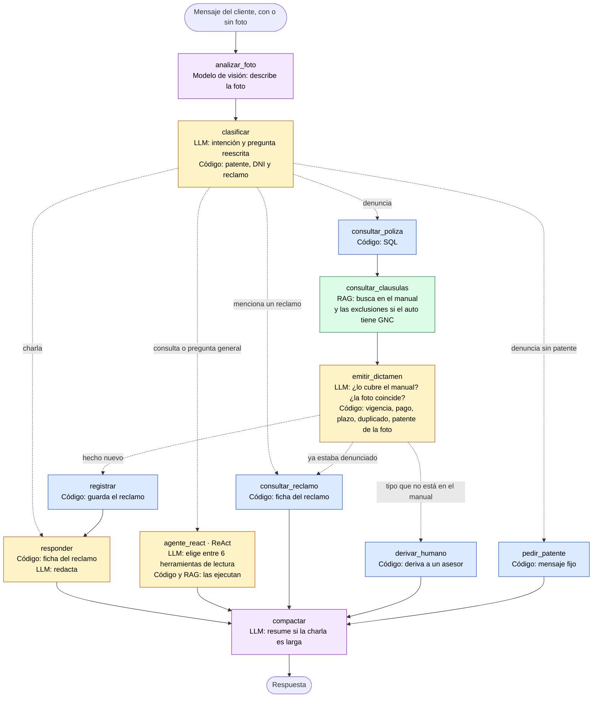

# Guía para las slides y la presentación (descartable)

Borrador de trabajo del grupo, **no va en la entrega**. Sirve para armar las
slides y lo que se dice sin volver a leer todo el proyecto.

**Formato:** no hay video. Es una **presentación oral con PowerPoint y
demostración en vivo** en la defensa (30/09 o 14/10), donde además preguntan
sobre el TP1 (ver `repaso_TP1.md`).

---

## 1. Qué evalúan, y dónde lo cubrimos

El enunciado pide que la presentación defienda cinco cosas, y evalúa seis
criterios. Cada bloque de la presentación apunta a uno o más:

| Lo que piden | Bloque |
|---|---|
| El caso de negocio elegido | 1 · El problema |
| Cómo fue resuelto con IA · *Aplicación del marco teórico* | 2 · Arquitectura (grafo + ReAct), 3 · RAG |
| *Funcionamiento del sistema* · Qué resultados obtuvieron | 4 · Demo, 6 · Resultados |
| Qué dificultades encontraron · *Identificación de dificultades* | 5 · Tres errores |
| Qué decisiones se tomaron y por qué · *Documentación técnica* | 2, 5 y 6 |
| *Creatividad y originalidad* | 1 (el caso), fotos, controles con código, la traza |

---

## 2. Estructura y tiempos (~15 minutos; ajustar al tiempo que dé la cátedra)

| # | Bloque | Tiempo | Slides | Quién |
|---|---|---|---|---|
| 0 | Apertura: equipo y qué es San Cris | 0:30 | 1 | *(a definir)* |
| 1 | El problema: la letra chica | 1:00 | 2 | |
| 2 | Arquitectura: el grafo, el ReAct y quién decide qué | 3:00 | 3-5 | |
| 3 | RAG: cómo busca en el manual | 1:15 | 6 | |
| 4 | Demo en vivo | 5:00 | (pantalla) | |
| 5 | Dificultades: tres errores, uno por pieza | 2:00 | 7-9 | |
| 6 | Resultados, costo e instalación | 1:15 | 10 | |
| 7 | Limitaciones y cierre | 0:45 | 11 | |

Si hay que recortar, se achica la demo (sacar los pasos 2-3) y el bloque de RAG.

---

## 3. Contenido de cada slide, con lo que se dice

El texto entre comillas es una propuesta de lo que se dice; conviene decirlo
con palabras propias. Los datos están verificados en `DOCUMENTACION.md`.

### Slide 1 — Portada
- **San Cris**: asistente de seguros de auto con RAG y agentes.
- TP2 de Inteligencia Artificial, UTN FRRO, comisión 502.
- Anmuth · Cabanellas · Casado · Escobar · Maragliano.

> "Somos… Hicimos San Cris, un asistente para los clientes de una aseguradora
> de autos, San Cristóbal."

### Slide 2 — El problema
- Los seguros están llenos de letra chica: coberturas, exclusiones,
  franquicias. Nadie lee el PDF de 27 páginas.
- El cliente quiere saber una cosa: **¿me cubre esto?**
- San Cris: el cliente cuenta lo que pasó (con una foto, si quiere) y recibe un
  **dictamen**: *Cubierto*, *Rechazado* o *Requiere peritaje*, con el
  fundamento del manual y un número de reclamo.

> "El cliente no tiene que saber qué plan tiene ni leer el manual: cuenta lo
> que le pasó y el sistema busca en el manual, cruza con su póliza y le
> responde si está cubierto y por qué."

### Slide 3 — Arquitectura: el grafo
- **Imagen: el grafo coloreado** (ver "Material a preparar"). Azul, código;
  verde, RAG; violeta, LLM; amarillo, LLM y código juntos.
- Construido con **LangGraph** (`StateGraph`). **Dos caminos:**
  - **Denuncias → camino fijo:** póliza, manual, dictamen, controles,
    registro. Siempre los mismos pasos, en el mismo orden.
  - **Consultas → agente ReAct** (`create_agent`): el modelo elige qué
    herramienta usar.
- Memoria con *checkpointer* + `thread_id`; en charlas largas, un resumen.
- Stack: LangChain, LangGraph, Groq (`gpt-oss-120b`, respaldo `gpt-oss-20b`,
  visión `qwen3.8-27b`), Chroma, e5, SQLite, Streamlit.

> "Un dictamen de cobertura tiene que seguir siempre los mismos pasos: no
> queríamos que el modelo decidiera si hoy revisa la vigencia o no. Para las
> consultas, en cambio, no hay un orden fijo: '¿qué reclamos tengo?' y
> '¿cuánto pago si el arreglo sale 800 mil?' necesitan herramientas distintas,
> y ahí dejamos que el modelo elija."

### Slide 4 — El agente ReAct y sus herramientas
- **ReAct = razonar + actuar:** el modelo decide qué herramienta llamar, la
  llama, mira el resultado y decide si necesita otra o ya puede responder.
- **Seis herramientas, todas de solo lectura** (`@tool`: la descripción sale
  del docstring):

| Herramienta | Qué hace |
|---|---|
| `consultar_datos_poliza` | La póliza de una patente (SQL) |
| `consultar_polizas_por_dni` | Las pólizas de un titular (SQL) |
| `consultar_clausulas_poliza` | Busca en el manual (RAG); con la patente, suma las exclusiones por GNC |
| `consultar_estado_reclamo` | La ficha de un reclamo |
| `listar_reclamos` | Los reclamos de un auto o de un titular |
| `calcular_pago_cliente` | Cuánto paga el cliente y cuánto la aseguradora: la cuenta la hace el código |

- **Registrar un reclamo no es una herramienta del modelo:** solo lo hace el
  camino fijo, después del dictamen y de los controles.
- **Traza observable:** debajo de cada respuesta, "🔍 Cómo llegué a esto":
  qué herramienta eligió, con qué datos, qué devolvió y los fragmentos del
  manual con su similitud.

> "El modelo puede leer todo lo que quiera, pero no puede escribir. Si le
> diéramos la herramienta de registrar, podría registrar un reclamo sin pasar
> por los controles de vigencia y pago, o registrarlo dos veces. Y la cuenta
> de cuánto paga el cliente no la hace el modelo: la hace una herramienta."

### Slide 5 — Quién decide qué (la idea central)

| Pieza | Qué hace | Cómo se comporta |
|---|---|---|
| **RAG** | Busca en el manual. No decide nada | Siempre igual |
| **LLM** | Interpreta: entiende el mensaje, elige herramientas, lee el manual, razona, redacta | Puede variar |
| **Código** | Verifica hechos y hace cuentas: póliza, fechas, vigencia, pago, plazo, duplicados, franquicia | Siempre igual |

> "El RAG es el bibliotecario que trae las páginas; el LLM es el perito que las
> lee y opina; el código es el área administrativa que revisa si la póliza está
> paga y vigente. Lo que se puede calcular lo decide el código; el modelo
> interpreta lo que no se puede calcular."

### Slide 6 — RAG: cómo busca en el manual
- El manual en PDF se corta **por los ítems numerados** (`10) Granizo`), y cada
  ítem lleva el título de su lista ("Exclusiones para robo…").
- **Búsqueda híbrida:** BM25 (palabras exactas: "granizo", "GNC") +
  embeddings `multilingual-e5-base` (el sentido: "me rompieron el vidrio"),
  combinadas con `EnsembleRetriever`.
- Si el auto tiene GNC, una **segunda búsqueda** dirigida a las exclusiones.

> "Probamos cortar el manual por cantidad de caracteres y el título quedaba
> separado del contenido. Y un buscador solo semántico no encontraba
> 'granizo': por eso la búsqueda híbrida."

### Bloque 4 — Demo en vivo (con el recorrido de la barra lateral)

Usar los botones del recorrido y escribir a mano las consultas marcadas con ✍️.
Abrir **"🔍 Cómo llegué a esto"** en las que dicen "traza".

| Paso | Consulta | Qué decir |
|---|---|---|
| 2 → 3 | *¿Qué plan tengo para la patente AB123CD?* → *¿Y cuándo vence?* | ReAct: eligió consultar la póliza. Memoria: la segunda no dice el auto |
| 4 | *¿Qué cubre el granizo?* | ReAct eligió buscar en el manual. **Traza**: pestaña Fuentes, con la similitud de cada fragmento |
| 5 | *Choqué contra un poste con la AB123CD, se abolló la puerta* | Camino fijo: dictamen cubierto con franquicia; la ficha del reclamo la arma el código |
| ✍️ | *Si arreglar la puerta sale 800.000 pesos, ¿cuánto pago yo?* | ReAct eligió `calcular_pago_cliente`: $460.000 el cliente, $340.000 la aseguradora. La cuenta la hizo el código. **Traza** |
| ✍️ | *¿Qué reclamos tengo?* | ReAct eligió `listar_reclamos` con la patente que recordaba |
| 7 → 8 | Robo del AC456BD → robo del AF987XX | Mismo plan, uno con GNC: el segundo se rechaza por una exclusión del manual |
| 9 | *Me robaron el auto AJ222NP* | Póliza vencida. **Traza**: "el modelo había dicho Cubierto; lo cambió un control del sistema" |
| 12 | Granizo sobre la AB123CD + foto de un choque | La foto no coincide con el relato: pide peritaje |

Mostrar también, debajo de una respuesta, **los tokens y el costo** del turno.
Si sobra tiempo: ✍️ *Se me rompió el motor en la ruta con la AC456BD,
necesito una grúa* → Asistencia 24.

### Slides 7 a 9 — Dificultades: tres errores, uno por pieza

Resolvimos más de 35 problemas (tabla completa en `DOCUMENTACION.md`). Estos
tres muestran cómo pensamos cada uno:

**7 · Falla del RAG: el GNC.** El robo de un auto con GNC salía cubierto, aunque
el manual lo excluye. El modelo razonaba bien: **la regla nunca le llegaba**,
porque nadie escribe "tengo GNC" al denunciar un robo. Además, cada ítem del
manual perdía el título de su lista y la exclusión se aplicaba donde no
correspondía. El arreglo fue en la búsqueda, no en el modelo.

**8 · Falla del LLM: el Cruze.** El robo del Chevrolet Cruze con GNC salió
cubierto 1 vez de 5. **La regla le llegaba** (se verificó) y aun así razonó
mal. Los modelos no son completamente deterministas, ni con `temperature=0`.
Decidimos aceptarlo y explicarlo.

**9 · Tarea mal asignada: la póliza vencida.** Salía cubierta: el modelo tenía
las dos fechas a la vista y no las comparaba. **Comparar fechas nunca fue
trabajo para el modelo**: pasó al código, y desde entonces no falla. Con la
misma idea: el pago, el plazo de denuncia de 72 horas, los reclamos
duplicados, la cuenta de la franquicia y el número de reclamo (el modelo, al
redactar, llegó a dar un número equivocado: ahora la ficha la arma el código).

> "Cada error nos enseñó a qué pieza le corresponde cada tarea."

Otras que se pueden nombrar si sobra tiempo: la foto de un choque con relato
de granizo salía cubierta (se resolvió con una llamada aparte: una tarea por
llamada); el modelo de visión confundía granizo con nieve (se probaron tres
redacciones de sus instrucciones); el cupo diario se agotaba (modelo de
respaldo automático); con el ReAct, un pedido que buscaba varias veces en el
manual superaba el límite de tokens por minuto del plan gratuito (se acotó
cuánto texto recibe por búsqueda).

### Slide 10 — Resultados
- **Batería final con el modelo principal:** 23 de 25 correctos; de los 2
  restantes, uno era un error de la verificación automática y el otro, el
  Cruze.
- **ReAct:** en las pruebas, el modelo eligió la herramienta correcta en todas
  las consultas (póliza, DNI, manual, reclamos, cuánto paga), con el modelo
  principal y con el de respaldo.
- **Costo:** un dictamen usa ~9.000 tokens, unos US$ 0,002: **~500 dictámenes
  por dólar**. Una consulta por el ReAct, ~3.000-5.000 tokens. Con el plan
  gratuito, unos 20 dictámenes o 45 consultas por día.
- **Fotos:** un modelo de visión describe el daño; no decide la cobertura.
- **Instalación con un solo comando:** `python iniciar.py`. Probado desde cero:
  10 minutos.

### Slide 11 — Limitaciones y cierre
- El dictamen puede variar (el Cruze).
- El modelo de visión puede equivocarse: por eso solo describe.
- El granizo o el parabrisas de un auto con GNC: el manual es ambiguo.
- El plazo de denuncia no contempla caso fortuito o fuerza mayor.

> "La lección más grande: el modelo de lenguaje es muy bueno interpretando y
> malo verificando. Un sistema confiable combina las dos cosas: que el código
> decida lo que se puede calcular y el modelo interprete lo demás."

---

## 4. Material a preparar

- **El grafo coloreado:** copiar este bloque en https://mermaid.live y exportar
  PNG o SVG.

- **Capturas** (por si la demo en vivo falla): respuesta del GNC rechazado, la
  póliza vencida con su traza ("el modelo había dicho Cubierto…"), la cuenta de
  cuánto paga, la foto que no coincide, la ficha del reclamo, el costo debajo
  de una respuesta.
- **Tabla de las tres piezas** (slide 5), **tabla de herramientas** (slide 4) y
  **stack** (slide 3).

## 5. Antes de presentar

- [ ] Llegar con el **cupo renovado** del modelo principal: no correr pruebas
      con la misma cuenta en las 24 horas anteriores (la demo completa usa
      ~80.000 tokens) y dejar el selector de la web en `gpt-oss-120b`.
- [ ] **Vaciar la tabla de reclamos** (las pruebas quedan como precedentes y
      como duplicados):
      `python -c "import sqlite3;c=sqlite3.connect('data/seguros_tp.db');c.execute('DELETE FROM siniestros');c.commit()"`
- [ ] Abrir el chat antes de empezar y hacer una consulta de prueba: la primera
      tarda porque carga el modelo de embeddings.
- [ ] Reiniciar la conversación en la web.
- [ ] Zoom del navegador al 125 % para que se lea en el proyector.
- [ ] **Que no se vea la API key** (ni el `.env` ni la terminal donde se pegó).
- [ ] Ensayar una vez la demo: los dictámenes tardan entre 30 y 60 segundos;
      tener algo para decir mientras tanto (por ejemplo, abrir la traza del
      paso anterior).
- [ ] Tener las capturas a mano por si falla la conexión o se agota el cupo.

## 6. Para generar las slides con otro asistente

Pasarle este archivo y la imagen del grafo, con un pedido como:

> "Armá una presentación de 11 slides con esta guía (una slide por cada
> «Slide N» de la sección 3), estilo sobrio, poco texto por slide, con la
> imagen del grafo en la slide 3 y las tablas de las slides 4 y 5. Las citas
> entre comillas son lo que se dice: ponelas en las notas del orador, no en la
> slide. Entre la slide 6 y la 7 va la demo en vivo: agregá una slide que diga
> solo «Demo»."
